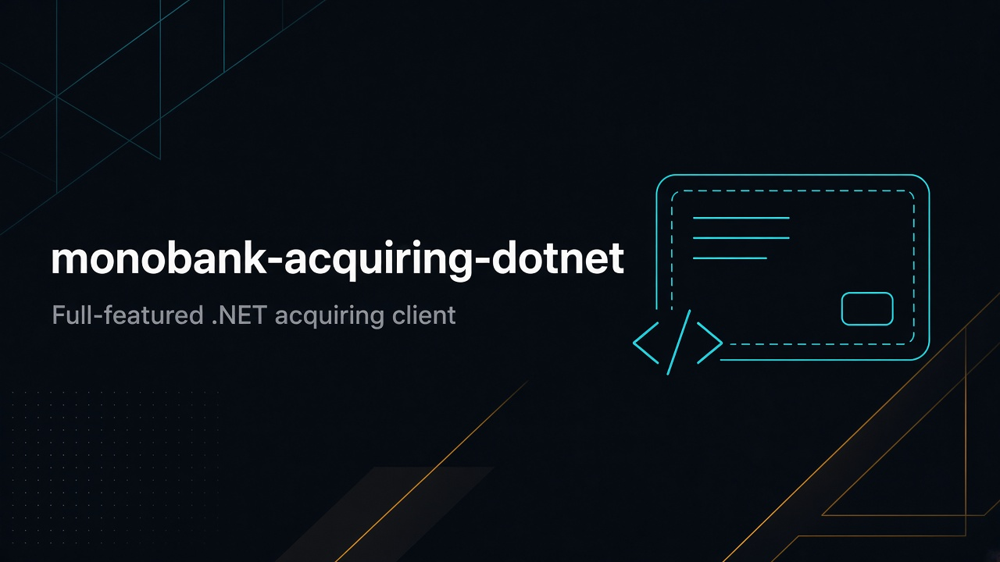

# monobank-acquiring-dotnet

Unofficial .NET SDK for Monobank Acquiring API. Create invoices, use hosted checkout, and verify ECDSA webhooks.

Not affiliated with monobank.

[](https://www.nuget.org/packages/MonoBank.Acquiring)
[](https://www.nuget.org/packages/MonoBank.Acquiring)
[](https://github.com/ConstantinOr/monobank-acquiring-dotnet/actions/workflows/ci.yml)
[](LICENSE)

**Targets:** `netstandard2.0` · `net10.0` (LTS)

Also covers wallets, subscriptions, split, POS, and T2P — one `MonoAcquiringClient`.

[Українською](#українською) · [English](#english)

<p align="center">
  
</p>

---

## English

### Install

```bash
dotnet add package MonoBank.Acquiring
```

### Run in one minute

```bash
export MONOBANK_TOKEN=your_x_token_here   # from https://web.monobank.ua/ or test token
dotnet run --project samples/QuickStart
```

Default is **read-only**: merchant details + webhook public key.  
To create a real invoice:

```bash
dotnet run --project samples/QuickStart -- --create-invoice
```

Or copy `samples/QuickStart/appsettings.example.json` → `appsettings.json` (gitignored) and set `MonoBank:Token`. Never commit real tokens.

```csharp
using var http = new HttpClient
{
    BaseAddress = new Uri(MonoAcquiringOptions.DefaultBaseAddress)
};
var mono = new MonoAcquiringClient(http, new MonoAcquiringOptions { Token = token });

var invoice = await mono.CreateInvoiceAsync(new CreateInvoiceRequest
{
    Amount = 4200, // minor units: 4200 = 42.00 UAH
    Ccy = 980,
    RedirectUrl = "https://example.com/result",
    WebHookUrl = "https://example.com/mono/webhook",
});

Console.WriteLine(invoice.PageUrl); // pay.mbnk.biz — hosted checkout
```

### Requirements

| | |
|---|---|
| Library TFMs | `netstandard2.0`, `net10.0` |
| Runs on | .NET Framework 4.6.1+, .NET Core 2.0+, .NET 5+ / .NET 10 |
| Build / tests | .NET 10 SDK |
| Auth | Merchant `X-Token` |

On `netstandard2.0` the package uses `System.Text.Json` / `System.Net.Http.Json`. On `net10.0` — BCL only.

### API surface

| Area | Methods |
|------|---------|
| Invoice | `CreateInvoiceAsync`, `GetInvoiceStatusAsync`, `CancelInvoiceAsync`, `RemoveInvoiceAsync`, `FinalizeInvoiceAsync`, `GetReceiptAsync`, `GetFiscalChecksAsync`, `PaymentDirectAsync`, `SyncPaymentAsync` |
| QR / merchant | `GetQrListAsync`, `GetQrDetailsAsync`, `ResetQrAmountAsync`, `GetMerchantDetailsAsync`, `GetStatementAsync`, `GetEmployeesAsync`, `GetSubmerchantsAsync`, `GetPubKeyAsync` |
| Wallet | `GetWalletAsync`, `WalletPaymentAsync`, `DeleteCardAsync` |
| Subscriptions | `CreateSubscriptionAsync`, `GetSubscriptionStatusAsync`, `GetSubscriptionPaymentsAsync`, `GetSubscriptionsAsync`, `RemoveSubscriptionAsync`, `EditSubscriptionAsync` |
| Split | `GetSplitReceiversAsync`, `GetSplitReceiverAsync` |
| monopay | `ImportMonoPayKeyAsync`, `DeleteMonoPayKeyAsync`, `GetMonoPayKeysAsync`, `MonoPaySigner.Sign` |
| POS | `CancelPosTransactionAsync`, `GetPosCancelStatusAsync` |
| T2P | `GetTerminalsAsync`, `GetT2pPaymentStatusAsync` |
| Webhook | `WebhookVerifier.Verify`, `InvoiceStatus.Parse` |

Base: `https://api.monobank.ua/` · Auth: `X-Token` · Optional: `X-Cms`, `X-Cms-Version`.

This library **receives** payments (acquiring). No personal P2P / Open API currency rates. Closest outbound: refunds, split, tips.

### Webhooks

```csharp
if (!WebhookVerifier.Verify(body, xSign, pubKey.Key))
    return; // reject

var status = InvoiceStatus.Parse(body);
```

### PCI

Hosted `pageUrl` checkout → no card data on your site.  
`PaymentDirectAsync` sends PAN/CVV — only with an active PCI DSS certificate.

### Tests & CI

```bash
dotnet test
```

GitHub Actions builds, tests, and packs on every push; tags `v*` publish a GitHub Release with `.nupkg`.

### Docs

- [Acquiring API](https://monobank.ua/api-docs/acquiring)
- [Invoice create](https://monobank.ua/api-docs/acquiring/methods/ia/post--api--merchant--invoice--create)
- [NuGet](https://www.nuget.org/packages/MonoBank.Acquiring)
- [Release v1.0.0](https://github.com/ConstantinOr/monobank-acquiring-dotnet/releases/tag/v1.0.0)

---

## Українською

Неофіційний .NET SDK для [API еквайрингу monobank](https://monobank.ua/api-docs/acquiring). Створення рахунків, hosted checkout і перевірка ECDSA-вебхуків.

Не афілійовано з monobank.

[](https://www.nuget.org/packages/MonoBank.Acquiring)
[](https://www.nuget.org/packages/MonoBank.Acquiring)
[](https://github.com/ConstantinOr/monobank-acquiring-dotnet/actions/workflows/ci.yml)
[](LICENSE)

**Таргети:** `netstandard2.0` · `net10.0` · **Ліцензія:** MIT

### Встановлення

```bash
dotnet add package MonoBank.Acquiring
```

### За хвилину

```bash
export MONOBANK_TOKEN=your_x_token_here
dotnet run --project samples/QuickStart
```

За замовчуванням лише merchant info + pubkey (без створення рахунку).  
Реальний invoice:

```bash
dotnet run --project samples/QuickStart -- --create-invoice
```

Токен у git не комітьте. Деталі API — в англійській секції. Документація: [еквайринг](https://monobank.ua/api-docs/acquiring).
